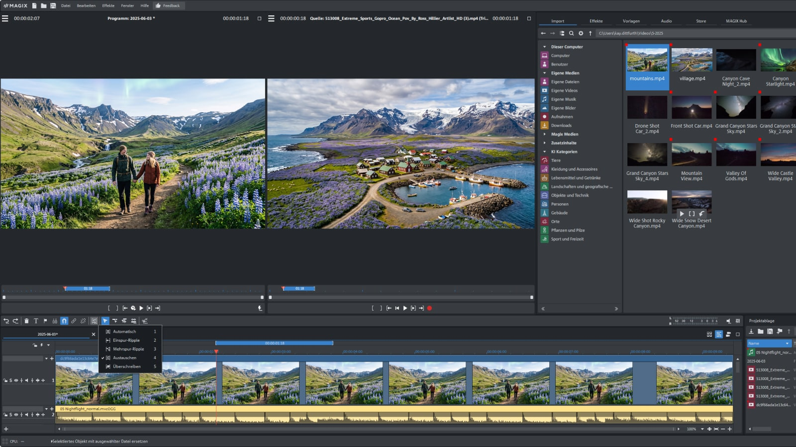
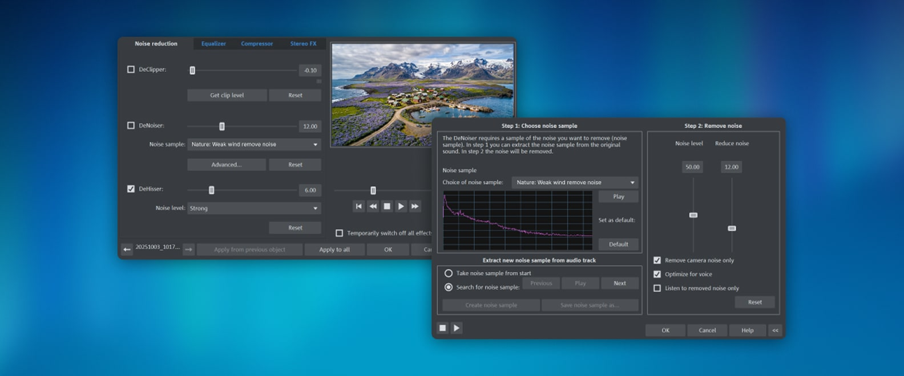

# MAGIX Video Pro X Editing Workflow Guide

MAGIX Pro X is a search phrase used here for MAGIX Video Pro X, the Windows video editor.
This independent guide explains editing, preview, and delivery workflows.
Readers comparing magix video pro x ultimate, magix video pro x18, and magix video pro x14 should distinguish bundle contents from application versions.

MAGIX develops the product.
The included Shotcut files are reference materials from a separate video editor.

[](https://magix-pro-x.github.io/MAGIX-Video-Pro-X/)

## Features

Video Pro X combines timeline editing with source and program monitors.
Its documented tools include proxy editing, multicam workflows, color correction, and audio processing.

| Workflow | Intended use | Review question |
| --- | --- | --- |
| Source selection | Mark the portion of a clip to use | Are the source In and Out points correct? |
| Timeline assembly | Arrange picture and sound | Do cuts preserve timing and continuity? |
| Proxy editing | Improve preview responsiveness | Are the original media files still available? |
| Multicam editing | Select between synchronized camera angles | Do picture and sound remain aligned? |
| Color correction | Adjust exposure and shot consistency | Is the project color workflow consistent? |
| Titles and subtitles | Add readable on-screen text | Are spelling, timing, and placement correct? |
| Export | Produce a delivery file | Does the result match the required specification? |

The current product page presents Video Pro X18 in Classic and Ultimate bundles.
Ultimate includes additional plug-ins and content; check the current comparison before relying on a bundled extra.

The [official product page](https://www.magix.com/us/video-editor/video-pro-x/) documents the available editions.
AI service allowances and offline features should be checked separately for the version being evaluated.



For an editing review, use a short sequence containing representative footage.
Include a title, a transition, dialogue, and at least one demanding section.

The Shotcut snapshot includes related test cases:

- [test_subtitles.cpp](tests/test_subtitles.cpp) checks subtitle-related behavior.
- [test_mix_transition_order.cpp](tests/test_mix_transition_order.cpp) checks ordering of mix transitions.
- [test_gpuinfo.cpp](tests/test_gpuinfo.cpp) exercises GPU information handling.
- [test_dataqueue.cpp](tests/test_dataqueue.cpp) checks data queue behavior.

These tests belong to Shotcut.
They do not validate MAGIX functionality or establish its internal architecture.

## Documentation

Separate project preparation, editing performance, and final delivery when evaluating a workflow.
An improvement in preview playback does not by itself verify the exported file.

MAGIX documents proxy editing as using lower-resolution copies during editing.
The original higher-resolution files are used for export by default.

A practical proxy review should record:

- The source media locations.
- Project resolution and frame rate.
- Whether proxy generation is enabled.
- Available storage for generated files.
- Preview behavior on a representative section.
- The settings used for the final export.

The [proxy documentation](https://help.magix-hub.com/video/videoprox/en/content/topics/proxy.htm) describes this workflow in the versioned help.
Check the installed version's help when locating individual controls.

For color and effects, compare the result across several shots.
A visually attractive single frame may hide an abrupt change at a cut.

The included Shotcut filter sets provide separate configuration references:

- [Soft Focus](filter-sets/Soft%20Focus) stores an MLT-based soft-focus filter combination.
- [Glow Intensity](filter-sets/Glow%20Intensity) stores a glow-related filter combination.
- [Obscure With Blur](filter-sets/Obscure%20With%20Blur) stores a masking and blur combination.

These files use Shotcut and MLT conventions.
They are not MAGIX presets and should not be presented as directly importable effects.

For delivery, write down the target resolution, frame rate, codec, and audio requirements.
Then compare the exported file with those requirements.

The [MAGIX export help](https://help.magix-hub.com/video/videoprox/16/en/content/topics/movieexport.htm) explains format-dependent export settings.
Its interface details apply to the documented version.

A public MAGIX batch-render command line has not been confirmed.
The following PowerShell example uses ffprobe from FFmpeg to inspect an existing file.

```powershell
$sourceFile = 'C:\VideoReview\delivery.mp4'
$probe = ffprobe -v error -show_entries stream=codec_name,width,height,r_frame_rate -of json $sourceFile | ConvertFrom-Json
$probe.streams | Format-Table -AutoSize
```

This requires ffprobe on PATH.
It reads media metadata and does not render a MAGIX project.

See the [ffprobe documentation](https://ffmpeg.org/ffprobe.html) for field selection and JSON output.
Metadata inspection complements watching and listening to the exported sequence.

The Shotcut reference [test_exportpresetdialog.cpp](tests/test_exportpresetdialog.cpp) checks export preset dialog behavior.
It is unrelated to MAGIX's preset storage format.

## Developers

The supplied collection is a partial Shotcut source snapshot.
It contains tests, filter sets, logging components, and maintenance scripts.
It is not MAGIX source code or a complete buildable Shotcut checkout.

For a reproducible timing calculation, retain a rational frame rate instead of rounding it early.
This original Python example calculates the duration of a constant-frame-rate segment.

```python
from fractions import Fraction
frame_rate = Fraction(30000, 1001)
frame_count = 1800
print(f"Duration: {float(frame_count / frame_rate):.3f} seconds")
```

This is ordinary Python code, not a MAGIX scripting interface.
It does not infer the duration of variable-frame-rate footage from a single nominal frame rate.

The reference snapshot includes:

- [minimalmediaplugin.cpp](MinimalMediaBackend/minimalmediaplugin.cpp) implements a minimal Qt multimedia platform plug-in.
- [CMakePresets.json](CMakePresets.json) records Shotcut build configurations.

Those components explain aspects of the reference project.
They do not establish MAGIX runtime dependencies.



## Dependencies

Video Pro X is a Windows application.
Verify current operating system, GPU, driver, storage, and format requirements against the intended version.

Hardware acceleration should be assessed using representative source footage and the required export format.
Support for one codec or operation does not prove acceleration for every stage of a project.

A useful performance comparison keeps these conditions consistent:

- Source files and project content.
- Preview quality and proxy settings.
- Output resolution and codec.
- Driver version and selected hardware.
- Background workload.

The Shotcut utility [ffmpeg-codecs.sh](scripts/ffmpeg-codecs.sh) inspects FFmpeg codec information for development use.
Its results should not be interpreted as MAGIX's supported-format list.

## Report a bug

A useful report describes the shortest sequence that reproduces the problem.
Include the application version, source format, project settings, and the action that triggers it.

For an export problem, distinguish among:

- A failure to complete rendering.
- An output file that cannot be opened.
- Incorrect picture or sound.
- A mismatch between intended and actual metadata.

The reference snapshot includes logging components:

- [Logger.cpp](CuteLogger/src/Logger.cpp) coordinates logging within the bundled CuteLogger component.
- [RollingFileAppender.cpp](CuteLogger/src/RollingFileAppender.cpp) handles rolling file output.
- [ConsoleAppender.cpp](CuteLogger/src/ConsoleAppender.cpp) writes log records to console error output.

These files are inspection references.
They do not describe where MAGIX stores diagnostic logs.

## Translations

For title and subtitle reviews, check the actual delivery language and typeface.
Inspect accented characters, punctuation, line breaks, and text near frame boundaries.

The Shotcut snapshot contains additional maintenance utilities:

- [update-tx.sh](scripts/update-tx.sh) updates translation files.
- [make-ico.py](scripts/make-ico.py) creates a Windows icon from prepared PNG images.

These scripts belong to Shotcut's maintenance workflow.
They are not MAGIX subtitle generators or language-pack installers.

## License

Check MAGIX's current offer for edition contents, upgrade eligibility, and service allowances.
A third-party plug-in bundle may have separate activation and licensing requirements.

The supplied Shotcut materials retain their respective project and component notices.
This guide does not provide a MAGIX license or redistribute the application.

## Related Search Terms

MAGIX Pro X, MAGIX Video Pro X, magix video pro x ultimate, magix video pro x18, magix video pro x14, video-editing, video-editor, nonlinear-editing, timeline, subtitles, color-grading, audio, windows, multimedia, rendering
